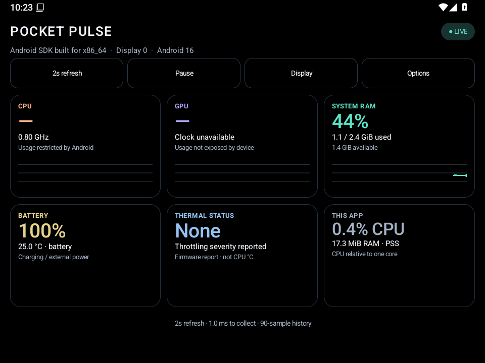
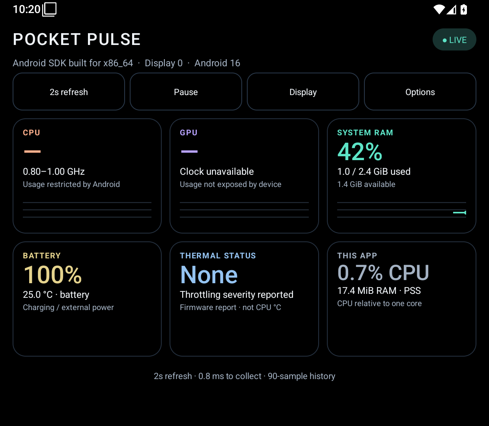

# Pocket Pulse — Android handheld performance monitor

Version 0.1.0. Native Java / Android framework only. Android 8.0 (API 26) or newer, targeting API 36. No external runtime libraries. No account or GitHub required.

[Download the APK](https://github.com/TygerBytes2026/pocket-pulse/releases/download/v0.1.0/Pocket-Pulse-0.1.0.apk) · [Release notes and downloads](https://github.com/TygerBytes2026/pocket-pulse/releases)

This is an early test build. CPU/GPU availability and game performance impact still need testing on physical handhelds.

## Landscape previews

Actual Android 16 emulator captures, not device photos. Readings and display density on a physical handheld will differ. These show 4:3 (960 × 720) and a Thor-shaped lower-screen window (1240 × 1080, approximately 31:27). The Thor manual lists its secondary panel as 1080 × 1240; this preview uses its landscape orientation. See the [AYN manual](https://device.report/manual/20399569).

| 4:3 landscape | Thor-shaped lower screen |
| --- | --- |
|  |  |

## Install

Copy `dist/Pocket-Pulse-0.1.0.apk` to the handheld and open it in its file manager. If Android asks, allow that file manager to install unknown apps, then install. This is a locally signed development build, not a Play Store release.

Open Pocket Pulse on the lower screen using the handheld's launcher or screen-switch shortcut. Alternatively, tap **Display** and select an accessible display. Android and the manufacturer's firmware control whether that move is allowed. Start the game on the other screen. It also supports split screen, portrait, landscape, and resizing.

## Readings

- CPU: system-wide utilization from `/proc/stat` where allowed. This is commonly restricted on Android 8+. CPU policy frequencies are separately shown when readable; frequency is not utilization.
- GPU: Qualcomm KGSL percentage or busy/total counters and clocks where readable. Support depends on the device kernel and SELinux policy. Other GPU drivers without these endpoints show unavailable. An idle `0/0` counter is unavailable, not 0% utilization.
- RAM: `(totalMem - availMem) / totalMem` from `ActivityManager`. Device-wide, including the system and some cache; not per-game allocation. Uses binary GiB.
- Battery: charge percentage and battery temperature from Android's battery broadcast. Battery temperature is not CPU/GPU temperature.
- Thermal: Android 10+ thermal severity. `None` means no severity reported by firmware, not proof that the device is cool or unthrottled.
- This app: whole-process CPU as a percentage of one core (can exceed 100% across cores), plus proportional set size (PSS, MiB) sampled at most every 15 seconds. CPU includes the monitor's own UI work over the interval. The collection time is elapsed time for telemetry reads, not total rendering cost or game performance impact.

A dash means a reading is unavailable or awaiting a valid interval. There are no estimated/fake utilization numbers. Without additional privileges, Android does not provide universal device CPU/GPU load, per-game RAM/CPU/GPU, or another game's FPS. Actual availability on the Retroid and AYN models must be tested on those devices.

## Low activity design

- Default refresh: 2 seconds. Choose 1, 2, 5, or 10 seconds; preference is saved.
- One background HandlerThread. Native views. No WebView, Compose, game FPS hook, shell polling, or third-party SDKs.
- Pure black (`#000000`) canvas, metric cards, and idle controls for OLED screens. Colored text and thin outlines retain contrast.
- Fixed 90-sample charts. Redraw on updates only; no continuous animation or 60 Hz loop. Changing intervals, pausing, or hiding clears history so gaps are not presented as continuous measurements.
- Read while started/visible, including a paused Activity on the other display. Stop when hidden or manually paused. No service, overlay, wake lock, boot receiver, network permission, analytics, or storage permission.
- Unreadable counter endpoints are disabled for the session after one failed probe. A relaunch probes again.
- Compact cards are automatic on short windows; they can also be enabled in Options. Cards scroll if the window cannot fit them. Standard buttons support touch and directional/controller focus.
- Keep-screen-awake is enabled while visible; Options can turn it off or dim this app's window to 25%. The second display itself still consumes power.

This design aims to minimize overhead. No specific CPU, RAM, battery, or FPS impact is guaranteed before testing on real handhelds. The overhead card helps inspect that on-device.

## Device report

**Options → About / readings → Copy device report** copies the model, Android version, detected displays, source paths, and current readings. Nothing is sent anywhere. Useful for improving device-specific support.

## Build from source on Windows

Install JDK 17 and Android SDK Platform 36 plus Build-Tools 36.0.0 from the official Android SDK distribution. Then run:

```powershell
.\build.ps1 -JavaHome 'C:\path\to\jdk-17' -AndroidPlatform 'C:\Android\Sdk\platforms\android-36' -BuildTools 'C:\Android\Sdk\build-tools\36.0.0'
```

The script runs AAPT2, javac, D8, zipalign, and apksigner directly, then executes the standalone telemetry regression checks. No Gradle download or dependency resolution is needed. It also works without arguments in the original workspace alongside the prepared `.toolchain` directory.

The first build creates `.signing/pocket-pulse-local.p12`, a local development key with alias `pocketpulse` and password `pocketpulse-local`. Keep that directory private and backed up to sign compatible updates. The source ZIP excludes the key. A fresh key cannot update an installed APK signed with the original key; uninstalling the previous build is then required. Use a separate private release key if publishing this app later.

The APK contains only Java bytecode/resources and supports ARM64, ARM32, and x86 Android devices. `dist/SHA256SUMS.txt` records the exact APK hash.

## Validation

Build verification checks bytecode compilation, APK signatures, ZIP alignment, manifest/package metadata, and regression cases for CPU/GPU counters, resets, invalid readings, memory units, process CPU normalization, and chart storage. See `VALIDATION.md` for the actual run results and remaining hardware checks.

## Contributing and license

Contributions are welcome. See [CONTRIBUTING.md](CONTRIBUTING.md). The source is available under the [MIT license](LICENSE).

Android references: [multiple displays](https://developer.android.com/reference/android/app/ActivityOptions#setLaunchDisplayId(int)), [visible Activity lifecycle](https://developer.android.com/guide/components/activities/activity-lifecycle), [memory APIs](https://developer.android.com/reference/android/app/ActivityManager), [app SELinux restrictions](https://android.googlesource.com/platform/system/sepolicy/+/main/private/untrusted_app_all.te), [thermal APIs](https://developer.android.com/reference/android/os/PowerManager).
